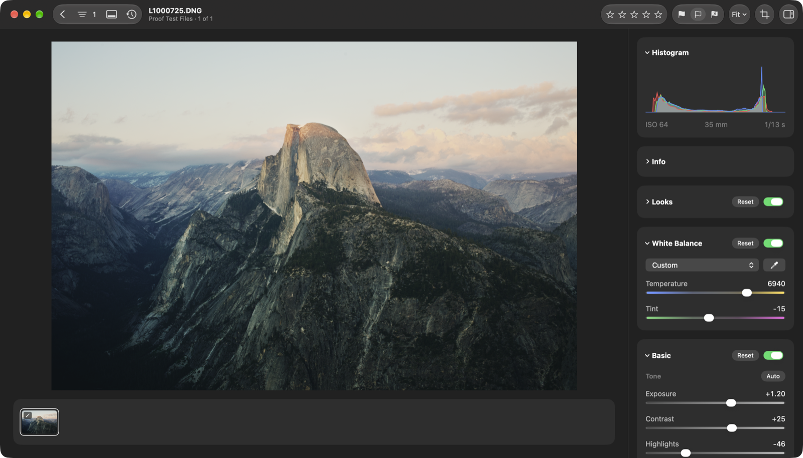
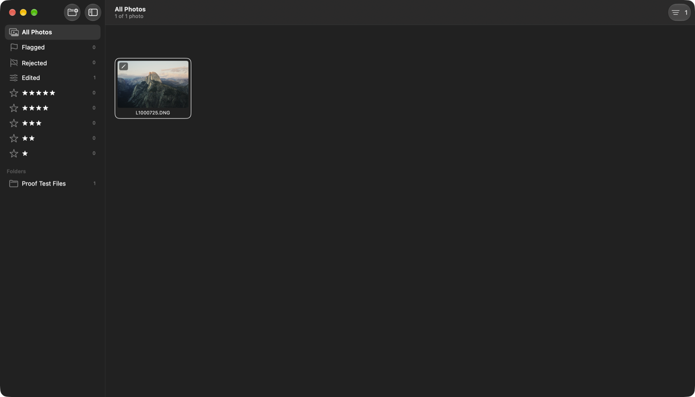

# Proof

Proof is a RAW photo editor for the Mac. It opens photos where they already are, on your Mac, an external drive or a network drive, and never changes the original files. Your edits are saved in a small file next to each photo, so there is no catalog or library to import into or keep in sync.



## Features



**Browse and organize**

- Folders shown as they are on disk, with an All Photos view across every folder you've added
- A thumbnail grid and a filmstrip while editing
- Star ratings, pick and reject flags, and filters that combine them
- Lightroom's keys for rating and flagging (0–5, P, U, X), on the Mac and on iPad with a keyboard
- Ratings and flags read from and saved to XMP sidecars, so other photo apps see them
- An Info panel with camera details, and a title, caption, keywords, creator, copyright and location
- Folders on external and network drives; renamed photos are found again with their edits

**Edit**

- The camera maker's color profile embedded in DNGs such as the Leica M11's, or Apple's, with the profile in use shown for every photo
- White balance (with an eyedropper), exposure, contrast, highlights, shadows, whites and blacks
- Texture, clarity, dehaze, vibrance and saturation, and an Auto button
- Tone curve for all channels or red, green and blue separately, with a histogram
- Selective color: hue, saturation and brightness for eight color ranges
- Black and white with red, green and blue filters
- Sharpening and noise reduction, with zoom to 100% and beyond
- Lens corrections from the camera's profile, manual distortion, chromatic aberration and lens vignetting
- Perspective correction, automatic or guided by lines you draw
- Crop, straighten, rotate and flip
- Spot removal for dust and blemishes, as circles or strokes painted over hairs and scratches, healed or cloned from a source Proof picks and you can move
- Masks: linear and radial gradients, a brush, and the photo's subject, each with its own exposure, tone, presence and color sliders
- Before and after, undo, and a History panel to step back through changes
- Copy and paste settings between photos

**Looks and effects**

- Import `.cube` LUT files into a library, preview them on the photo and set their strength
- Vignette, film grain, halation and bloom

**Export**

- JPEG, HEIC and TIFF, at full size, a long edge in pixels, or a print size
- sRGB, Display P3 or Adobe RGB color
- Several photos at once in the background, keeping camera details, rating and description
- Saved export destinations for folders you export to often
- On iPad and iPhone, to the share sheet, Files or Photos

## Install

Proof needs a Mac with Apple silicon (M1 or later) running macOS 27 or later.

1. Download the `.dmg` file from the [latest release](https://github.com/KevinDSimon/Proof/releases/latest).
2. Open it and drag Proof to the Applications folder shown beside it.
3. Open Proof from Applications. The first time, macOS asks you to confirm that you want to open an app downloaded from the internet.
4. Choose File › Add Folder… (⌘O) and pick a folder of RAW, JPEG or HEIC photos. JPEG and HEIC photos can be rated and flagged; editing them comes in a later version. Proof sees only the folders you choose, and remembers them the next time it opens.

Proof opens the RAW formats macOS supports, including DNG and the formats of most current cameras.

Your original photos are never changed. Edits go into a `.proof` file next to each photo, and ratings and flags into an `.xmp` file, which other photo apps can read too. To remove everything Proof added to a folder, delete those files.

To report a problem, [open a bug report](https://github.com/KevinDSimon/Proof/issues/new/choose).

## Build from source

You need a Mac with Apple silicon, macOS 27 and Xcode 27 or later.

1. Clone this repository and open `App/Proof.xcodeproj` in Xcode.
2. Choose the **Proof** scheme and **My Mac** as the destination.
3. Choose Product › Run (⌘R).

The app is signed to run locally, so you don't need an Apple developer account. To build and test the editing engine from the command line:

```bash
swift build
swift test
```

| Path | What it is |
| --- | --- |
| `App/` | The Mac app and the iPad and iPhone app (SwiftUI) |
| `Sources/ProofKit` | The editing engine: edit settings, rendering, sidecars, XMP and LUTs. It builds for macOS and iOS, so a later iPad and iPhone app can reuse it. |
| `Sources/ProofUI` | The app model the Mac app shares with the iPad and iPhone app |
| `Tests/ProofKitTests` | Tests for the engine |
| `docs/` | Architecture, the edit file format, releasing, the roadmap and decision records |
| `scripts/release.sh` | Builds a signed, notarized `.dmg` for a release |

## Contributing

Work is tracked in [GitHub Issues](https://github.com/KevinDSimon/Proof/issues), grouped into milestones. Each change goes through a pull request that closes its issue. See [CONTRIBUTING.md](CONTRIBUTING.md) for how to run the full tests and what a pull request needs.
